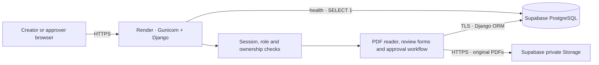

# Manab Tikadar · 23JE0543

## Purchase order review for PEP Brands

## [OPEN LIVE APP](https://mcaffeine-po-23je0543.onrender.com/)

[DEMO video](https://drive.google.com/file/d/1EDLMe3M1aJdPlEEl38MFUsC_XZDhw3Pm/view?usp=sharing) · [Login credentials](#login-credentials) · [Database health](https://mcaffeine-po-23je0543.onrender.com/health) · [Test PDFs](brief/) · [AI conversation](ai-session/conversation.md)

Operations uploads the supplier’s original, corrects the extracted figures and submits the PO. Finance can return it with a reason or approve it. The owner can reopen the original and history from the same PO after the decision.

### Login credentials

| Username | Demo password | Role | Try |
|---|---|---|---|
| creator1 | `E1nTKv1z22sX48AUX9xZ9Qcup+5O1sp/hA2yR8uIpe4=` | Creator | Upload and correct a PO |
| creator2 | `poWWwFOAZ+YSvqLIlxPgyuZicQGi3zR/xCIfF3Q/KLI=` | Creator | Upload a duplicate of creator1’s PO |
| approver1 | `qh+wj45LrDvhzHuMfC5Xa+eAZ9pJggmgIj+xqL2tgnM=` | Approver | Reject, then approve the corrected PO |
| lead1 | `3GPgsiBM4Wqxc1xdpIBfQdOlClSz0YxOuFVvhpt0+7U=` | Creator + Approver | Submit a PO and verify self-approval returns 403 |

Use these accounts to test the public demo with sample purchase orders.

1. Open the live app in a private window. Sign in as **creator1**. Download [review-po.pdf](brief/review-po.pdf), choose it and click **Upload and review**. Expect `PO-REVIEW-0543`, one amber-bottle row and ₹60.00. If that number is already in use, create a manual draft with a fresh number, attach the PDF, and enter 28-11-2026, Review Packaging, three bottles at ₹20 each and ₹60 for both totals.
2. **Submit** and note the PO page URL. As **approver1**, open the submitted queue, select that number, enter “Specify bottle material” and **Reject**.
3. As **creator1**, reopen the same PO, change the description to “Amber glass bottle” and submit again. As **approver1**, open it from the queue and **Approve**.
4. As **creator1**, reopen the saved URL. Check the corrected row, final **Approved** status and four history entries in order: Submitted, Rejected, Resubmitted, Approved. Check the actors, times and rejection reason. **Open original PDF** should still show the original wording. The automated workflow test repeats the approval POST as finance and checks for HTTP 409 and exactly four entries.

### Architecture and upload journey



**Upload and review** sends one PDF (up to 5 MB) with the session and CSRF token. Django checks the Creator role and reads the text with pdfplumber. Inside a transaction it creates the draft and editable rows, verifies the bucket is private, uploads the original under a generated key and commits. A normalized PO-number constraint catches duplicates across creators before the file is stored. The browser follows a redirect to the detail page. The preview requests the PDF through Django, which checks access before fetching the stored bytes.

Django’s server-rendered templates handle the UI. Sessions and Argon2 password hashes live in PostgreSQL alongside orders, integer-paise amounts and append-only history. The service uses UTC for audit times. **/health** checks the database and returns 503 on failure. PDF storage has a separate failure path.

### PDF coverage and checks

| Fixture | Expected result |
|---|---|
| Sample 1 · digital | Five editable rows, ₹2,54,200.00. MC-027’s wrapped description ends in “Arabica Extract and Walnut Shell 250g”. |
| Sample 2 · mismatch | Three lines total ₹1,24,500.00 against ₹1,42,500.00 printed. Review shows the ₹18,000 difference. Submission keeps the PO in Draft. |
| Sample 3 · resent | Upload after sample 1 as **creator2**. The duplicate-number message reveals no owner or PO contents. |
| Sample 4 · garbled | Manual-entry message, blank header and rows, readable original alongside. |
| Review PO · custom | One row, quantity 3 × ₹20.00. Use for the approval walkthrough above. |

Level 1 requires at least two recognizable labelled header values before prefilling. Level 2 reads the supplied digital table layout and joins description continuations. Dates accept ISO, day-first numeric separators and abbreviated month names. The display uses DD-MM-YYYY. Amounts accept ₹, Rs., INR and comma grouping. Submission requires number, date, vendor and total, positive quantities and prices, and checks row multiplication and the sum within ₹1. With zero rows it displays **Line items not checked**.

Scans, garbled layers and unfamiliar table layouts need human review. There is no OCR stage. A next step would render unreadable pages as images, apply OCR, then pass the results through the same editable review and arithmetic checks.

### Server permissions

[Access rules](orders/access.py) return **401** for anonymous API calls. HTML pages redirect to login. Creators see their own orders; approvers can also open submitted orders. A private PO or original outside that scope returns **404** to avoid disclosing its existence. [Draft handlers](orders/drafts.py) restrict editing to the owner in Draft or Rejected. [Decision handlers](orders/views.py) return **403** for an ineligible role or self-decision, **400** for a missing rejection reason and **409** for a repeated approval. A row lock serializes decisions. The transition and its history entry commit together; a database trigger protects existing entries.

### Run locally

Use Python 3.12, PostgreSQL and a private Supabase Storage bucket named `po-originals`. From the project root on Windows:

```powershell
py -3.12 -m venv .venv
.\.venv\Scripts\Activate.ps1
python -m pip install -r requirements.txt
Copy-Item .env.example .env
```

Fill the ignored `.env` using `NAME=value`. Set the Django secret, PostgreSQL URI, four initial demo passwords, Supabase project URL and service-role key. For a loopback development database without TLS append `?sslmode=disable` to its URI. Use a disposable local database role with permission to create a test database.

```powershell
python manage.py migrate
python manage.py provision_accounts
python manage.py test config orders
python manage.py runserver
```

Open http://127.0.0.1:8000/. Provisioning sets passwords when accounts are first created. Tests use a separate test database and mock object storage. [Render deployment configuration](render.yaml) installs dependencies, applies migrations, provisions accounts and starts Gunicorn on the assigned port.

**Release checks, 28 November 2026.** All 21 local tests passed with the five PDFs present. In a fresh Edge InPrivate profile, the public raw README led to the Render sign-in form and a healthy database response. An anonymous live API request returned 401. The authenticated walkthrough and retrieval from live Storage still require the current demo passwords.
