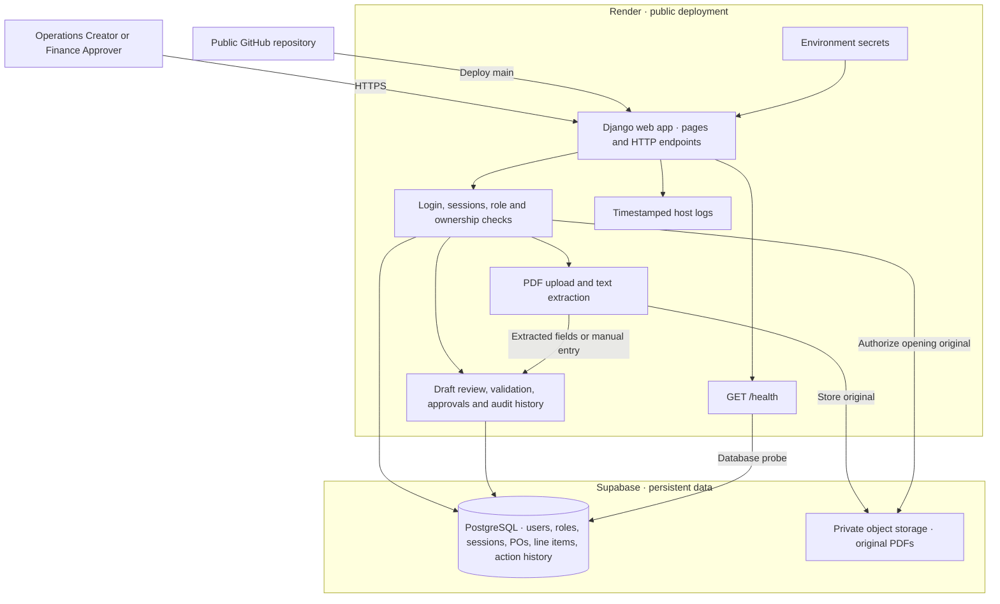

## User

Read the assignment PDF and all four sample PDFs in brief/. Inspect the existing repository. Before editing code, tell me what already works, what remains, and the smallest architecture you recommend. Give me a milestone checklist in the order we should build it, including the public deployment. For each milestone, tell me one thing I can personally do to verify it. Use the actual sample PDFs to determine expected results. Stop after the plan.Also give me High level Diagram of My Project everything fromm databases to the internal services , and the public deployment

## Assistant

I’ll read the assignment and all four samples, then inspect the repository and run any existing checks that can verify what works. I’ll use those findings to build the milestone plan and architecture diagram, and stop before editing code.

## Assistant

The repository has one commit containing only the project title. I also found a difference that matters for testing: the assignment’s example has three lines, while the actual clean sample has five and totals ₹2,54,200. I’ll use the supplied files as the acceptance cases.

## Assistant

**Build the manual purchase-order workflow first, deploy it in the first three hours, and then add PDF extraction to the same form.** That gives you a working tool for Operations and Finance even when a PDF is unreadable. It also puts the two compulsory parts of the assignment first. [Assignment brief](<C:/Users/User/Downloads/mcaffin_project/brief/PEP Brands FDE Technical Assignment.pdf>)

## What already works and what remains

The Git repository is initialized on `main`. Its configured remote is named `23JE0543_mCaffeine_FDE`, which matches the assignment’s naming convention. The only commit contains a one-line [README](C:/Users/User/Downloads/mcaffin_project/README.md). The assignment and all four sample PDFs are present locally in `brief/` and are currently untracked.

**There is no application to run or test yet.** Login, permissions, PO creation, approval history, PDF storage and extraction, the database, and public deployment all remain to be built. I inspected the files without changing the repository or deploying anything.

## Expected results from the actual PDFs

| File | What the document contains | What you should see in the app |
|---|---|---|
| [1 · Digital](C:/Users/User/Downloads/mcaffin_project/brief/sample_1_digital.pdf) | `PO-2026-001`, ABC Industries, `15-11-2026`. Five line amounts of ₹60,000, ₹28,500, ₹36,000, ₹31,500 and ₹98,200. | An editable draft with **5 rows**. Printed and calculated totals both equal **₹2,54,200.00**. The fourth row, `MC-027`, keeps the complete description “Coffee Body Scrub with Arabica Extract and Walnut Shell 250g”. |
| [2 · Mismatch](C:/Users/User/Downloads/mcaffin_project/brief/sample_2_mismatch.pdf) | `PO-2026-003`, XYZ Cosmetics LLP, `20.11.2026`. Three rows add to **₹1,24,500.00**. The PDF prints **₹1,42,500.00**. | Show both totals and the **₹18,000.00** difference. All three rows pass their individual checks. The draft stays editable and the server blocks submission until the discrepancy is resolved. |
| [3 · Resent](C:/Users/User/Downloads/mcaffin_project/brief/sample_3_resent.pdf) | A signed copy of sample 1. The date is written `15 Nov 2026`. The PO number, five rows and total are the same. | After sample 1 exists, uploading this file returns “PO number already exists,” including when uploaded by the other creator. The original record is preserved and the message reveals no owner or contents. |
| [4 · Garbled](C:/Users/User/Downloads/mcaffin_project/brief/sample_4_garbled.pdf) | The visible page shows `PO-2026-005`, Green Leaf Naturals, `22/11/2026`, four rows and **₹1,91,400.00**. Its embedded text is gibberish. | Show “This PDF can’t be read automatically,” keep the original available, and open an empty manual form. Entering the four visible amounts of ₹52,800, ₹59,400, ₹34,200 and ₹45,000 should reconcile to the printed total. OCR is optional and earns no screening marks. |

## Smallest architecture I recommend

Use **one Django application on Render and one Supabase project for PostgreSQL and private PDF storage**. Django serves the pages, handles login and runs the permission, parsing and approval logic. Its built-in sessions, forms, groups and database transactions cover most of the compulsory work. Use `pdfplumber` inside the upload request for the digital samples. The original PDF and the business records both survive an app redeploy. Use the free, no-card options and keep the deployment accessible through review. [Render free hosting](https://render.com/docs/free) · [Supabase free plan](https://supabase.com/pricing) · [Private storage and signed URLs](https://supabase.com/docs/guides/storage/buckets/fundamentals)



**Upload journey.** A signed-in creator uploads one PDF up to 5 MB. Django checks access, stores the original privately, reads the text layer and looks for recognizable PO fields. It saves a draft with the file’s storage key and extraction method, then returns the editable review page. On submit, Django checks the saved values again. On approval or rejection, it commits the status change and the history entry in one database transaction. Opening the original from the PO page requires a fresh access check before issuing a short-lived signed link.

## Milestone checklist

| # | Build in this order | One thing you can personally do to verify it |
|---|---|---|
| ☐ 1 | **Deploy a public skeleton within 3 hours.** Connect GitHub to Render, connect Django to hosted PostgreSQL, and add `/health`. Return `200` after a successful database query and `503` if it fails. Configure environment secrets, a names-only `.env.example`, friendly errors and timestamped logs. | Open the public `/health` URL on your phone using mobile data. A `200` confirms the public app can reach its database. |
| ☐ 2 | **Add login and the four accounts.** Configure Argon2 password hashing. Give `creator1` and `creator2` the Creator role, `approver1` the Approver role, and `lead1` both. Enforce roles and ownership on the server. Use `401` for an unauthenticated API request, `403` for a forbidden action and `404` for another creator’s private PO. | Request the protected PO list while signed out and confirm the server returns `401`. |
| ☐ 3 | **Build manual drafts and private attachments.** Save header fields, editable line items, printed total and the PDF storage key. Give the normalized PO number a database-wide unique constraint. Let creators list and open their own POs and reopen the original from the detail page. | Create a draft as `creator1`, copy its detail URL, then open it as `creator2`. You should get `404`. |
| ☐ 4 | **Implement the approval workflow and history.** Only the owner edits drafts or rejected POs. Submission locks the contents. Approvers see the submitted queue and can approve or reject another person’s PO. Rejection requires a reason. Resubmission uses the same record. Approval is final. Record actor, action, server time and remark in append-only history. | Submit a PO as `lead1`, then call the approve endpoint directly as `lead1`. Expect `403`, status `SUBMITTED`, and no approval entry. |
| ☐ 5 | **Add server-side validation.** Require PO number, date, vendor and total. Store dates as ISO and display `DD-MM-YYYY`. Store money in integer paise. Require positive quantities and prices. Check both row multiplication and the PO sum within ₹1. Highlight failed fields and show “Line items not checked” when there are no rows. | Enter sample 2 manually and press Submit. The app should identify the ₹18,000 difference and keep the PO in `DRAFT`. |
| ☐ 6 | **Add Level 1 PDF reading.** Extract the header and printed total, handle the supplied date and currency formats, and save and display the extraction method. Recognize a garbled text layer even when it contains plenty of characters. | Upload sample 4. You should get the manual-entry message and a readable original PDF alongside an empty form. |
| ☐ 7 | **Add Level 2 line-item reading.** Extract SKU, description, quantity, unit price and printed line total into the existing editable table. Preserve wrapped descriptions and route extracted values through the same validation as manual entries. | Upload sample 1 and compare the form with the PDF. Count five rows, read the end of `MC-027`’s description, and check the ₹2,54,200 total. |
| ☐ 8 | **Verify the public release and submit.** Exercise all four samples, a PO you make yourself, duplicate uploads across creators, reject/edit/resubmit, and a repeated approval returning `409`. Commit as you go. Finish the two-page README with your name and admission number, live URL, four demo logins, local setup, diagram, upload journey, permission checks, PDF coverage and limitations. Include the unedited transcript in `/ai-session/` and a chat share link if supported. **Deadline: 28 November 2026 at 10:00 PM IST.** | Start in a private browser window with only the public README. Use its URL and logins to take one PO through rejection, correction, resubmission and approval. Verify that the same PO shows all four actions and still opens its original PDF. |

## User

Implement the deployment milestone using the agreed stack. Set up the smallest working app, hosted database connection, /health endpoint, .gitignore, and .env.example with variable names only. /health must check the database and return an error status if it is unreachable. Give me the exact dashboard steps for anything that needs my account. Keep credentials out of the chat and git. Run the available checks and distinguish local results from live results.

## Assistant

I’ll set up the Django app and database-backed health check, then test both the success and failure paths. I’ll also check which deployment steps need your Render or Supabase account so credentials can stay in the dashboards.

## Assistant

The Django routes and Render Blueprint are in place. The Blueprint uses Supabase for PostgreSQL and asks for the connection URL in Render’s dashboard. I’m testing `/health` against a temporary local PostgreSQL server so I can check outage and recovery without touching a hosted database.

## Assistant

The local HTTP test passed. `/health` returned `200` with PostgreSQL running, `503` after I stopped it, and `200` after I restarted it without restarting Django. The outage log contained the error class and no test credentials. I’ll commit the verified deployment files so Render can use the Blueprint.

## Assistant

**Implemented and pushed to `main` in commit `7904ab6`.** The Django app, PostgreSQL connection, `/health` endpoint, Render Blueprint, `.gitignore`, and names-only `.env.example` are on GitHub. No credentials were committed or shared in chat. **Local verification passed. Public deployment still needs your Supabase and Render accounts.** [Commit](https://github.com/manabtikadar/23JE0543_mCaffeine_FDE/commit/7904ab6) · [Deployment README](https://github.com/manabtikadar/23JE0543_mCaffeine_FDE/blob/main/README.md)

### Local results

Every `/health` request executes `SELECT 1`. I tested it over HTTP against a real, temporary PostgreSQL server, keeping Django running throughout.

| Database state | HTTP result | Response |
|---|---|---|
| Running | `200` | `{"status":"ok"}` |
| Stopped | `503` | `{"status":"unavailable"}` |
| Restarted | `200` | `{"status":"ok"}` |

Both regression tests, Django’s standard checks, and the dependency check passed. The outage produced a timestamped log entry without credentials. Django’s separate deployment check reported three advisories under simulated Render settings. Two concern optional HSTS settings. The third concerns Django’s preferred 50-character secret length; Render generates a random 256-bit secret whose encoded form is shorter. [Render secret generation](https://render.com/docs/blueprint-spec#generating-random-secrets)

### Dashboard steps to go live

1. **Create PostgreSQL in Supabase.** Open **New project**, choose a Free organization, enter a project name, select **Singapore**, and generate a database password. Save it in your password manager, click **Create new project**, and wait for provisioning. [Supabase Dashboard](https://supabase.com/dashboard)
2. **Get the connection URI.** In the project, click **Connect**. Choose **URI → Session pooler** and confirm port **5432**. Replace the password placeholder privately with your database password. Percent-encode reserved characters if present. The app requests TLS automatically. [Supabase connection guide](https://supabase.com/docs/guides/database/connecting-to-postgres)
3. **Deploy the Blueprint in Render.** Choose **New → Blueprint**, connect GitHub, and select **manabtikadar/23JE0543_mCaffeine_FDE**. Enter a Blueprint name, choose branch **main**, and keep the path **`render.yaml`**. Paste the completed URI into the **`DATABASE_URL`** secret field. Confirm the preview shows **one Free web service** and click **Deploy Blueprint**. Render generates `DJANGO_SECRET_KEY` and configures `/health` for you. [Render Dashboard](https://dashboard.render.com/) · [Blueprint guide](https://render.com/docs/infrastructure-as-code)
4. **Verify the live result.** Open the service’s **Events** tab and wait for **Live**. Copy its public hostname and run `curl.exe -i https://YOUR-SERVICE.onrender.com/health`. **HTTP `200` with `{"status":"ok"}` verifies the public Render app can reach Supabase.** If deployment stays unhealthy, open **Logs** and recheck the pooler URI in **Environment**.

## User

the first database connect to the render public url deployment done 
now do the second phase 
Add login and the four accounts. Configure Argon2 password hashing. Give creator1 and creator2 the Creator role, approver1 the Approver role, and lead1 both. Enforce roles and ownership on the server. Use 401 for an unauthenticated API request, 403 for a forbidden action and 404 for another creator’s private PO.

## Assistant

I’ll inspect the deployed app’s configuration, then add login, the four role assignments, and server-side access checks. I’ll test the 401, 403, and 404 cases and make sure the account setup can run again without resetting passwords.

## Assistant

I found a database password in a local edit to `.env.example`. It appeared in an inspection result. I’ll remove it from the template and keep it out of Git. Please rotate the database password in Supabase and update `DATABASE_URL` privately in Render. Don’t paste either value here.

## Assistant

What is the public Render URL you deployed? I can use it to verify the anonymous API response after the update. Please send only the public HTTPS address.

## Assistant

What is the public Render URL you deployed? I can use it to verify the anonymous API response after the update. Please send only the public HTTPS address.

## User

do the remaining task

## User

do the remaining task

## User

do the remaining task

## Assistant

I’ve finished and locally verified the login and access-control code. I’m checking the live deployment and the Git state next, then I’ll tell you whether anything still needs your Render dashboard.

## Assistant

**The remaining task isn’t live yet.** I implemented and locally verified the login and role checks, but couldn’t stage or push the changes because this workspace denied access to the Git index. The public URL configured in the project, `mcaffeine-po-23je0543.onrender.com`, also couldn’t be reached from this environment, so I couldn’t verify or update Render.

The code provisions all four accounts with Argon2-hashed passwords supplied through private environment variables. The account command preserves existing passwords across deploys. Anonymous API requests return `401`; users without the required role get `403`; a creator requesting another creator’s PO gets the same `404` as a nonexistent PO. Nine local tests passed against temporary PostgreSQL, including the role assignments, password preservation, and access checks.

I also removed the database connection string from `.env.example`, which had been changed locally to contain it. Since that connection string included a database password and had appeared in a tool result, **rotate the Supabase database password and update `DATABASE_URL` privately in Render**. Keep the replacement out of chat and Git.

The code changes are still in the workspace, but remain uncommitted and undeployed. Once the updated branch is pushed, Render needs four private variables: `CREATOR1_PASSWORD`, `CREATOR2_PASSWORD`, `APPROVER1_PASSWORD`, and `LEAD1_PASSWORD`. Generate separate passwords in Render, then redeploy. The start command runs migrations and provisions accounts before starting Django. Please provide your public Render URL if it differs from the URL configured in the project.

## User

the first database connect to the render public url deployment done
now do the second phase
Add login and the four accounts. Configure Argon2 password hashing. Give creator1 and creator2 the Creator role, approver1 the Approver role, and lead1 both. Enforce roles and ownership on the server. Use 401 for an unauthenticated API request, 403 for a forbidden action and 404 for another creator’s private PO.
this past is done ?

## Assistant

I’ll check the current commit and public endpoints so I can tell you whether phase two is live or only verified locally.

## Assistant

Phase two is now on GitHub in commit `a9cee6e`. I’ll check when Render starts serving the new login page and returns `401` for the private PO list.

## Assistant

**Yes. Phase two is deployed.** I verified that the [live login page](https://mcaffeine-po-23je0543.onrender.com/login/) returns `200` and the [PO list](https://mcaffeine-po-23je0543.onrender.com/api/pos/) returns `401` when signed out.

`creator1` and `creator2` have the **Creator** role, `approver1` has **Approver**, and `lead1` has both. The deployment provisions the four accounts with **Argon2id** password hashes.

All nine local tests passed, including sign-in for all four accounts, `403` for a forbidden action, and `404` when one creator opens another creator’s private PO. Authenticated checks ran locally. To verify ownership live, use the passwords in **Render → your service → Environment**, create a draft as `creator1`, then open its URL as `creator2`. You should see `404`.

If you haven’t already rotated the Supabase database password exposed earlier, rotate it and update `DATABASE_URL` privately in Render.

## User

how i can test it manually

## Assistant

Use a regular browser window for `creator1` and a private window for `creator2`. This keeps their sessions separate.

**Get the passwords.** In Render, open your web service → **Environment**. The initial passwords are in `CREATOR1_PASSWORD`, `CREATOR2_PASSWORD`, `APPROVER1_PASSWORD`, and `LEAD1_PASSWORD`. Use them on the [live sign-in page](https://mcaffeine-po-23je0543.onrender.com/login/). Keep them out of chat and screenshots.

| Step | What to do | Expected result |
|---|---|---|
| 1. Check signed-out access | Before signing in, open the [PO list](https://mcaffeine-po-23je0543.onrender.com/api/pos/) in the private window. | **401** and `{"detail":"Sign in required."}` |
| 2. Create a private PO | In the regular window, sign in as `creator1`. Enter a unique PO number, click **Create draft**, then click the new PO number. **Copy its detail URL.** | The workspace shows **Creator**. The detail page returns **200** and shows your PO number with status `DRAFT`. |
| 3. Check ownership | In the private window, sign in as `creator2` and paste the exact URL copied in step 2. | **404** and `{"detail":"PO not found."}`. The draft is also absent from `creator2`’s PO list. |
| 4. Check a forbidden action | While signed in as `creator2`, open the [approval queue](https://mcaffeine-po-23je0543.onrender.com/api/approval-queue/) directly. | **403** and `{"detail":"Permission denied."}` |
| 5. Check the Approver role | Sign out, sign in as `approver1`, and open the same approval queue. | The workspace shows **Approver**. The queue returns **200**. An empty list is expected if there are no submitted POs. |
| 6. Check both roles | Sign out and sign in as `lead1`. Create a fresh draft, then open the approval queue. | The workspace shows **Creator** and **Approver**. Draft creation succeeds and the queue returns **200**. |

To see the actual HTTP status in Chrome or Edge, press **F12 → Network**, reload the page, and read the **Status** column for the document request.

Argon2id hashing is a separate database check. In the **Supabase SQL Editor**, run this read-only query. It shows a yes/no result without displaying any password hashes. Expect four rows, all `true`.

```sql
SELECT username, password LIKE 'argon2$argon2id$%' AS uses_argon2id
FROM public.auth_user
WHERE username IN ('creator1', 'creator2', 'approver1', 'lead1')
ORDER BY username;
```

## User

ok this part is also done now do the next part 
Build manual drafts and private attachments. Save header fields, editable line items, printed total and the PDF storage key. Give the normalized PO number a database-wide unique constraint. Let creators list and open their own POs and reopen the original from the detail page.

## Assistant

I’ll extend the existing draft and ownership checks, add editable PO details and private PDF storage, then verify that a creator can reopen the original and another creator can’t access it.

## Assistant

All 11 local tests passed against PostgreSQL. The new tests covered normalized duplicates and another creator’s access to the detail page and PDF. They used a storage mock, so a real Supabase upload still needs a live check.

## Assistant

**Manual drafts are deployed.** Sign in as `creator1`, create a draft, and click its PO number. The detail page lets you edit the PO number, date, vendor, printed total, and line items. PostgreSQL enforces uniqueness across creators and statuses, including PO numbers that differ only by case or surrounding spaces. [Open the app](https://mcaffeine-po-23je0543.onrender.com/)

**Private attachments need one account setup step.** The app saves the PDF’s storage key with the draft and checks access each time someone opens the original.

1. In **Supabase → Storage**, create a bucket named `po-originals` with **Public bucket** switched **off**.
2. In **Render → web service → Environment**, set `SUPABASE_URL` to your Supabase project’s HTTPS URL and `SUPABASE_SERVICE_ROLE_KEY` to its private `service_role` key. Save and deploy. Enter the key only in Render.

**Verification:** All 11 local tests passed against PostgreSQL. On Render, I confirmed that the new draft URL redirects signed-out visitors to login. The local PDF test used simulated storage, so the live upload and reopen still need confirmation.

To check that end to end, attach `sample_1_digital.pdf` as `creator1`, save, and click **Open original PDF**. Copy that PDF link and open it in a separate browser session signed in as `creator2`. The owner should see the PDF, and `creator2` should receive **404**.

## User

Fix the draft-save bug in my Django purchase-order app.

On the live Render app, I sign in as lead1 and open the existing draft
PO-LEAD-APPROVAL-001. I fill in Number, PO date, Vendor, and Printed total,
and enter one line item. When I click Save draft, the four header fields
come back blank, Number shows “This field is required,” and the line item
is still visible. The PO remains Draft, and I see no Submit button.

1. Reproduce the issue through the actual draft edit page. Inspect the
   template and form handling to find why the header fields are dropped
   or cleared. Check which fields are sent by Save draft and how Django
   binds them.
2. Fix the cause. The Number field should show the existing PO number
   when the draft opens. A valid save should persist the header fields
   and line items together. If validation fails, preserve the entered
   values and show the relevant errors.
3. Add and run a regression test that saves both the header fields and
   line items, then reopens the same PO and verifies the saved values.
4. Once saving works, check whether the PO owner has a Submit action.
   If it is missing or broken, fix it and verify that a valid draft moves
   to Submitted and appears in approver1's queue.
5. Report the root cause, files changed, and actual test results. Tell me
   which commit to deploy on Render and how to retest using the existing
   draft. Run tests with test data and keep live credentials out of output.

## Assistant

I’ll reproduce the save using the fields rendered by the edit page on a test database, then follow the same PO through reopening and submission. I’ll leave the live draft untouched.

## Assistant

Fixed the draft editor and added **Submit for approval**. The fix is in commit [`fd39bf1`](https://github.com/manabtikadar/23JE0543_mCaffeine_FDE/commit/fd39bf1) on `fix/draft-save-submit`. **All 12 tests passed** against disposable PostgreSQL. The live draft `PO-LEAD-APPROVAL-001` was untouched.

**Root cause.** On a GET request, the edit view passed an empty `request.FILES` to `HeaderForm`. Django treated the form as bound to an empty submission, so it displayed blank headers instead of the saved PO values. The line-item formset loaded its saved values normally. This also affected the GET immediately after a successful save, making saved headers appear lost. I reproduced the blank Number on the actual edit route. The rendered form included all four header field names, and I found no evidence that Save draft omitted them from the POST.

**What changed.** `orders/drafts.py` now binds the header form only on POST and handles owner submission. `orders/templates/orders/detail.html` adds the missing Submit button. The regression in `orders/test_drafts.py` failed before the fix because the existing Number rendered as `''`. It now verifies that all four headers and the line item survive save and reopen, invalid input stays visible, and a valid submission appears in `approver1`’s queue.

**Deploy and retest**

1. Merge `fix/draft-save-submit` into `main`, the branch connected to Render. Wait for the deployment containing `fd39bf1` to show **Live**. No database migration is required. [Open the branch comparison](https://github.com/manabtikadar/23JE0543_mCaffeine_FDE/compare/main...fix/draft-save-submit)
2. Sign in as `lead1` and open `PO-LEAD-APPROVAL-001`. **Number** should already show that exact value. Review any previously saved values before adding another line.
3. Fill in the header and line item, click **Save draft**, then leave and reopen the PO. Confirm the values persist and the status is still **Draft**.
4. When ready to send this existing PO to Finance, click **Submit for approval**. Confirm the status becomes **Submitted**, then sign in as `approver1` and open the [approval queue](https://mcaffeine-po-23je0543.onrender.com/api/approval-queue/).

## User

Implement the approval workflow and history. Only the owner edits drafts or rejected POs. Submission locks the contents. Approvers see the submitted queue and can approve or reject another person’s PO. Rejection requires a reason. Resubmission uses the same record. Approval is final. Record actor, action, server time and remark in append-only history. | Submit a PO as lead1, then call the approve endpoint directly as lead1. Expect 403, status SUBMITTED, and no approval entry.

## Assistant

I’ll check which draft changes are in the current branch, then implement the decision endpoints, rejection and resubmission, and PO history. I’ll verify the direct `lead1` self-approval case against a disposable database.

## Assistant

The direct self-approval test passed: `lead1` received `403`, the PO stayed `SUBMITTED`, and its only history entry was the submission. The full rejection, correction, resubmission, and approval sequence also passed on the same PO.

## Assistant

**Implemented the approval workflow. All 13 tests passed on disposable PostgreSQL.** After `lead1` submitted a PO, a direct `POST /api/pos/<id>/approve/` as `lead1` returned **403**. The PO stayed **SUBMITTED**, and its history contained exactly one entry: the original submission.

Only the owner can edit a draft or rejected PO. Submission locks its contents. Another approver can approve it or reject it with a reason. Rejection lets the owner correct and resubmit the same record. Approval is final, and a repeated decision returns `409`.

The PO detail page shows the actor, action, server time, and remark for each transition. Each status change and history entry is saved in one transaction. PostgreSQL also rejects updates and deletes to history entries. History starts with transitions performed after deployment.

**Deployment is pending.** Commit `d3a1e10` is on `feature/approval-workflow` and includes the preceding draft-save fix. Merge the branch into `main` to deploy through Render. The configured start command applies migration `0004_approval_history`. [Review the branch](https://github.com/manabtikadar/23JE0543_mCaffeine_FDE/compare/main...feature/approval-workflow)

## User

now tell me how i manually test it

## Assistant

First, check **Render → your web service → Events**. The live deployment must include commit `d3a1e10` from `feature/approval-workflow`. If it’s still on the earlier release, merge the workflow branch into `main` and wait for Render to show **Live**. [Review the branch](https://github.com/manabtikadar/23JE0543_mCaffeine_FDE/compare/main...feature/approval-workflow)

Use a **fresh test PO** so you can take it all the way to final approval. Sign in as `lead1` in a regular browser window and as `approver1` in a private window. Keep both open. [Sign in](https://mcaffeine-po-23je0543.onrender.com/login/)

### 1. Submit as `lead1`

Create a draft with a unique number such as `PO-WORKFLOW-TEST-001`. Enter a date, a vendor, and one line item with quantity `2`, unit price `100.00`, line total `200.00`, and printed total `200.00`. Click **Submit for approval**.

**Expected:** The detail page shows **Submitted**, the editing controls disappear, and **Action history** contains one **Submitted** entry by `lead1`. Keep this detail page open.

### 2. Call the approve endpoint directly as `lead1`

In the **`lead1` window**, while on the submitted PO’s detail page, press **F12 → Console** and run the following. It uses your browser session, reads the PO ID from the page URL, and prints only the HTTP status and response.

```javascript
const poId = location.pathname.match(/^\/pos\/(\d+)\/$/)?.[1];
if (!poId) throw new Error("Open the PO detail page first.");

const csrfToken = document.cookie
  .split("; ")
  .find(cookie => cookie.startsWith("csrftoken="))
  ?.slice("csrftoken=".length);
if (!csrfToken) throw new Error("Refresh the page in the signed-in lead1 window.");

const response = await fetch(`/api/pos/${poId}/approve/`, {
  method: "POST",
  headers: { "X-CSRFToken": csrfToken }
});
console.log(response.status, await response.text());
```

**Expected:** `403 {"detail": "Permission denied."}`. Refresh the page. The PO must still be **Submitted**, with exactly one history entry and **no Approved entry**. If you see an HTML page saying *CSRF verification failed*, the request did not reach the role check. That result does not verify the self-approval rule.

### 3. Reject, correct, resubmit, and approve

| Who | What to do | Expected result |
|---|---|---|
| `approver1` | Open **Submitted PO queue**, select your PO, and click **Reject** with an empty remark. Then enter `Please correct the vendor name` and click **Reject** again. | The empty reason is blocked. The rejection with a reason succeeds, and the PO leaves the queue. |
| `lead1` | Refresh the original detail page. Read the rejection reason, correct the vendor, and click **Resubmit for approval**. | The same PO URL shows **Submitted** again. Its history now contains **Submitted → Rejected → Resubmitted**. |
| `approver1` | Refresh the queue, reopen that PO, enter `Vendor correction verified`, and click **Approve**. | The PO leaves the queue again. |
| `lead1` | Refresh the original detail page one final time. | The status is **Approved**, editing is locked, and history shows all four actions in order with the correct actors, timestamps, and remarks. |

## User

done all tests passed

## Assistant

Your manual tests confirm the approval workflow passed end to end. `lead1`’s direct self-approval returned `403`, the PO stayed `SUBMITTED`, and no approval entry was added. Rejection, correction, resubmission, and final approval all used the same PO and preserved its history.

The next milestone is **server-side validation**: verify the ₹1 tolerance for line and PO totals, normalize the supported currency formats, and use `sample_2_mismatch.pdf` to confirm its ₹18,000 discrepancy blocks submission.

## User

Add server-side validation. Require PO number, date, vendor and total. Store dates as ISO and display DD-MM-YYYY. Store money in integer paise. Require positive quantities and prices. Check both row multiplication and the PO sum within ₹1. Highlight failed fields and show “Line items not checked” when there are no rows. | Enter sample 2 manually and press Submit. The app should identify the ₹18,000 difference and keep the PO in DRAFT. |

## Assistant

I’ll update the draft editor and database schema together so existing rupee amounts keep their value when converted to paise. I’ll verify the submission rules using sample 2’s actual rows and printed total.

## User

do the unfinished work

## Assistant

The validation changes and sample 2 regression are in place. I’ll finish the database checks, including whether existing decimal amounts survive the migration exactly.

## Assistant

**Server-side validation is implemented. All 15 tests passed on disposable PostgreSQL.** Using sample 2’s actual values, the submit test found that the three lines totaled **₹1,24,500.00** against a printed total of **₹1,42,500.00**. The form highlighted the printed total, reported the **₹18,000.00 difference**, and kept the PO in `DRAFT` without recording a submission.

Submission requires a PO number, date, vendor, and printed total. Quantities and unit prices must be positive. Both arithmetic checks accept a difference of exactly ₹1 and reject ₹1.01. A PO with no rows displays **“Line items not checked.”**

Money is stored in integer paise. The migration test verified that existing amounts convert exactly and survive rollback. Dates are stored as database dates and displayed as `DD-MM-YYYY`.

**Render deployment is pending.** Merge `feature/po-validation` into `main` to deploy commit `305b00b` and apply migration `0005_money_in_paise`. [Review the branch](https://github.com/manabtikadar/23JE0543_mCaffeine_FDE/compare/main...feature/po-validation)

## User

now tell me how i can manually approve that

## Assistant

To manually verify the validation and then approve the PO, run sample 2 twice: first with its printed total to confirm submission is blocked, then with the corrected total to send it to Finance.

1. **Confirm the deployment.** In Render → your web service → **Events**, check that the live deployment includes commit `305b00b`. If it doesn’t, merge `feature/po-validation` into `main` and wait for **Live**. [Review the branch](https://github.com/manabtikadar/23JE0543_mCaffeine_FDE/compare/main...feature/po-validation)

2. **Sign in as `creator1` and create a draft.** Use `PO-2026-003`, or a fresh number such as `PO-2026-003-TEST-01` if the sample number already exists. Enter vendor **XYZ Cosmetics LLP**, date **20-11-2026**, and printed total **142500.00**. Add these three rows. [Open the app](https://mcaffeine-po-23je0543.onrender.com/login/)

   | SKU | Description | Quantity | Unit price | Line total |
   |---|---|---:|---:|---:|
   | MC-001 | Body Wash 200ml | 500 | 120.00 | 60000.00 |
   | MC-014 | Coffee Face Scrub 100g | 300 | 95.00 | 28500.00 |
   | HY-203 | Sunscreen SPF50 50ml | 200 | 180.00 | 36000.00 |

3. **Click Save draft, then Submit for approval.** Expect the printed total to be highlighted. The error should show a line sum of **₹1,24,500.00** and a difference of **₹18,000.00**. The PO should still be **Draft**, with no submission entry in its history. This verifies the mismatch check.

4. **Correct the total and submit again.** For this test, change only the printed total to **124500.00** and click **Submit for approval**. Expect **Submitted**, locked fields, and a submission entry by `creator1`.

5. **Approve as `approver1`.** In a private window, sign in as `approver1`, open **Submitted PO queue**, select the same PO, enter an optional remark, and click **Approve**. Refresh the creator’s detail page. The final confirmation is **Approved** with an **Approved** history entry naming `approver1` and showing the server time.

## User

it works perfectly 
now next stage 
Add Level 1 PDF reading. Extract the header and printed total, handle the supplied date and currency formats, and save and display the extraction method. Recognize a garbled text layer even when it contains plenty of characters. | Upload sample 4. You should get the manual-entry message and a readable original PDF alongside an empty form. |

## Assistant

I’ll add PDF upload to the creator’s workspace, reuse the existing draft form and private storage, and check the extraction results against all four supplied PDFs.

## Assistant

I confirmed that sample 4 contains a long string of symbols in its text layer. The reader now looks for recognizable PO labels and valid field values before filling the form. If those checks fail, it keeps the original PDF and opens a blank draft.

## Assistant

**Level 1 PDF reading is implemented.** Creators can choose **Upload and review** to prefill the PO number, date, vendor, and printed total. The draft saves and displays its extraction method. Line items remain available for manual entry.

All **17 tests passed** on disposable PostgreSQL. I uploaded all four supplied PDFs through the app’s review route with these results:

| Sample | Verified result |
|---|---|
| 1 · Digital | Extracted `PO-2026-001`, ABC Industries, `15-11-2026`, and ₹2,54,200.00. |
| 2 · Mismatch | Extracted `PO-2026-003`, XYZ Cosmetics LLP, `20-11-2026`, and the **printed** ₹1,42,500.00. |
| 3 · Resent | Recognized the existing PO number and rejected the duplicate. |
| 4 · Garbled | Showed **“This PDF can’t be read automatically”** and opened a blank manual form. The preview endpoint returned the original PDF bytes. |

**Render deployment is pending.** Merge `feature/pdf-level-one` into `main` to deploy commit `4084277`. The tests used a storage mock. To verify the live preview after deployment, sign in as `creator1`, choose **Upload and review**, and upload `sample_4_garbled.pdf`. You should see the readable original above the empty header fields, with **Open original PDF** available in a separate tab. [Review the branch](https://github.com/manabtikadar/23JE0543_mCaffeine_FDE/compare/main...feature/pdf-level-one)

## User

one thing from the date field you removed selecting from calender add it back

## Assistant

I’ll restore the calendar picker and keep the existing date formats and server-side validation working.

## Assistant

Restored the calendar picker beside **PO date**. Click **Choose date** to fill the field in `DD-MM-YYYY` format, or type the date manually.

All 17 local tests passed. Commit `e146c37` is on `feature/pdf-level-one`, pending deployment to Render. [Review the change](https://github.com/manabtikadar/23JE0543_mCaffeine_FDE/commit/e146c37)

## User

now give me steps for manual testing of the latest changes

## Assistant

**First check the deployment.** In **Render → your web service → Events**, confirm the live deploy includes `e146c37`. That commit includes both Level 1 PDF reading and the restored calendar picker. If it’s pending, merge `feature/pdf-level-one` into `main` and wait for **Live**. [Review the branch](https://github.com/manabtikadar/23JE0543_mCaffeine_FDE/compare/main...feature/pdf-level-one)

### Test the garbled PDF and calendar together

1. Sign in as `creator1`. Under **Read a purchase order PDF**, select `brief/sample_4_garbled.pdf` and click **Upload and review**. [Open the app](https://mcaffeine-po-23je0543.onrender.com/login/)
2. Confirm the page says **“This PDF can’t be read automatically”** and shows **Manual entry (unreadable text layer)**. The PO number, date, vendor and printed total should be blank. In the original PDF preview, you should be able to read **Green Leaf Naturals**, **PO-2026-005** and **₹1,91,400.00**. Also try **Open original PDF**.
3. Click **Choose date** beside **PO date**. Select **22 November 2026**. The text field should immediately show **`22-11-2026`**. Reopen the calendar and confirm it opens on that date.
4. Enter a fresh test PO number, such as `PO-2026-005-TEST-01`, vendor `Green Leaf Naturals`, and printed total `191400.00`. Click **Save draft**, return to the workspace, and reopen that PO. Confirm the date, vendor, total, extraction method and original PDF persist.
5. Check that typing still works. Change the date manually to `23-11-2026`, then open the calendar. It should select **23 November**. Choose **22 November** again, save, and refresh.

### Test the digital PDFs

Use **Upload and review** for each file, in this order:

| File | Expected result |
|---|---|
| `sample_1_digital.pdf` | **PDF text layer**. Number `PO-2026-001`, vendor `ABC Industries`, date `15-11-2026`, printed total **₹2,54,200.00**. Open the calendar and confirm **15 November 2026** is selected. |
| `sample_2_mismatch.pdf` | **PDF text layer**. Number `PO-2026-003`, vendor `XYZ Cosmetics LLP`, date `20-11-2026`, printed total **₹1,42,500.00**. Level 1 reads the printed amount. The ₹18,000 mismatch becomes checkable once you enter the three line items. |
| `sample_3_resent.pdf` | After sample 1 exists, expect **“PO number already exists.”** No second draft should appear. |

If you already created `PO-2026-001` or `PO-2026-003` during earlier tests, its upload should trigger the duplicate message. You can still verify the calendar on an existing editable draft.

## User

2. Confirm the page says “This PDF can’t be read automatically” and shows Manual entry (unreadable text layer). The PO number, date, vendor and printed total should be blank. In the original PDF preview, you should be able to read Green Leaf Naturals, PO-2026-005 and ₹1,91,400.00. Also try Open original PDF. this is showing should i maually fill the details

## Assistant

Yes. For `sample_4_garbled.pdf`, the message and blank fields are the expected result. Use the readable original in the preview to fill in the draft:

| Field | Enter |
|---|---|
| PO number | `PO-2026-005` |
| PO date | Click **Choose date** and select **22 November 2026**. The field should show `22-11-2026`. |
| Vendor | `Green Leaf Naturals` |
| Printed total | `191400.00` |

Click **Save draft**, then reopen it from the workspace. Confirm the values are saved and **Open original PDF** still works. The extraction method should continue to say **Manual entry (unreadable text layer)** because you entered the details yourself.

For this test, saving the draft is enough. You can leave the line items blank and skip **Submit for approval**.

## User

then what to do

## Assistant

After you save sample 4, **reopen the draft from the workspace**. Confirm the date shows `22-11-2026`, the total shows `191400.00`, and **Open original PDF** still works. That completes the manual-entry and calendar test.

Next, return to the workspace and use **Upload and review** for the digital samples:

1. **Upload `sample_1_digital.pdf`.** Without typing anything, you should see `PO-2026-001`, `ABC Industries`, `15-11-2026`, and `254200.00`. The extraction method should say **PDF text layer**.
2. **Upload `sample_2_mismatch.pdf`.** Check that the printed total is `142500.00`. The line items stay empty at Level 1.
3. **Upload `sample_3_resent.pdf`.** Since it repeats sample 1’s PO number, expect **“PO number already exists.”**

If sample 1 or 2 already exists from earlier testing, a duplicate message is expected for that file too. **You don’t need to submit or approve any PO for this test.**

## User

all worked perfectly
but line items are empty

## Assistant

The current reader fills only the header and printed total. I’ll add line-item extraction to the same upload flow and check the wrapped description in sample 1 and the ₹18,000 mismatch in sample 2.

## User

but why the sample4 it chouldn't extract

## Assistant

Sample 4 looks readable because the PDF displays an **image** of the purchase order. You can see “Green Leaf Naturals” and `PO-2026-005` in that image. But when the app reads the PDF’s **text layer**, it gets hundreds of garbled symbols instead of those words and numbers.

That’s why both the header and the line items are empty. The assignment deliberately includes sample 4 to test this case. **The manual-entry message and readable original are the expected result.** Automatically reading this sample would require OCR, which recognizes text from the image itself.

Samples 1 and 2 are different: their text layers are readable. Their line items are empty because the current Level 1 reader extracts only the header and printed total.

## User

Add Level 2 line-item reading. Extract SKU, description, quantity, unit price and printed line total into the existing editable table. Preserve wrapped descriptions and route extracted values through the same validation as manual entries. | Upload sample 1 and compare the form with the PDF. Count five rows, read the end of MC-027’s description, and check the ₹2,54,200 total. |

now go to the next stage of building

## Assistant

I’ll add line-item reading to the digital PDF upload and verify the five populated rows against sample 1, including the second line of MC-027’s description.

## Assistant

**Level 2 PDF reading is implemented.** Digital uploads now fill the editable table with SKU, description, quantity, unit price, and printed line total. Extracted rows use the same validation as manually entered rows.

**All 18 local tests passed** on disposable PostgreSQL using the supplied PDFs and mocked private storage. Sample 1 produced **five populated rows** totaling **₹2,54,200.00**. The `MC-027` description was preserved in full: “Coffee Body Scrub with Arabica Extract and Walnut Shell 250g”. Sample 2 produced three rows, and its **₹18,000.00** discrepancy blocked submission. Sample 4 still opens for manual entry.

**Render deployment is pending.** Merge `feature/pdf-level-two` into `main` to deploy commit `a69f556`. No database migration is required. [Review the branch](https://github.com/manabtikadar/23JE0543_mCaffeine_FDE/compare/main...feature/pdf-level-two)

After deployment, open your existing sample 1 draft and click **Read line items from saved PDF** if its table is empty. This lets you verify the five rows without uploading a duplicate PO.

## User

you implemented the calender feature but previously there is small icon of calender on the right most side of date filed i want that

## Assistant

I’ll replace the separate “Choose date” button with a small calendar icon inside the right edge of the PO date field and keep manual date entry working.

## Assistant

The PO date field now has a small calendar icon inside its right edge. Click the icon to select a date, or type `DD-MM-YYYY` directly.

All 18 local tests passed. Commit `9105317` is on `feature/pdf-level-two`, pending deployment to Render. [Review the change](https://github.com/manabtikadar/23JE0543_mCaffeine_FDE/commit/9105317)

## User

I already added the all files and uploaded as draft now i can't upload the same file to check the level 2

## Assistant

Open the draft you already uploaded. Level 2 can read the PDF attached to it, so you can test it without uploading a duplicate.

1. In Render → **Events**, confirm the live deployment includes commit `a69f556` or `9105317`.
2. Sign in as the creator who uploaded sample 1 and open **`PO-2026-001`**.
3. If the line-item table is empty, click **Read line items from saved PDF** above the edit form.
4. You should see **five populated rows**. Check that `MC-027` ends with **“and Walnut Shell 250g”** and that the five printed line totals add to **₹2,54,200.00**.

You can repeat this on **`PO-2026-003`** for sample 2. It should populate **three rows**. Pressing **Submit for approval** should flag the **₹18,000.00** difference and leave the PO in **Draft**.

If the button is missing, check that the draft has an **Open original PDF** link, is **Draft** or **Rejected**, and has **no saved line items**. The button only appears on an editable PO with a stored PDF and an empty table. Sample 4’s garbled text layer still requires manual entry.

## User

The line items are still empty

## Assistant

I’ll trace the existing-draft flow and check when the page shows the read button, which PDF it reads, and what happens if extraction returns zero rows.

## Assistant

Which PO or sample shows empty rows, and what happens when you click “Read line items from saved PDF” (button missing, error message, or page reloads with empty rows)? Please omit credentials.

## Assistant

Which PO or sample shows empty rows, and what happens when you click “Read line items from saved PDF” (button missing, error message, or page reloads with empty rows)? Please omit credentials.

## User

no it works after i click read line from pdf

## Assistant

That’s expected for a draft created before Level 2. Clicking **Read line items from saved PDF** reads the attached PDF once and saves the rows to that draft. Reopen it and the rows should still be there.

New digital PDFs uploaded through **Upload and review** populate the rows automatically. For sample 1, you should see **five populated rows** totaling **₹2,54,200.00**, with `MC-027`’s description ending in **“and Walnut Shell 250g.”**

## User

PO-2026-003 but for this after the line extraction the wrong sum gives no warning

## Assistant

I’ll check when the totals are compared and make the discrepancy visible on the draft immediately after extraction, while keeping the existing submission block.

## Assistant

The warning was only shown when you clicked **Submit for approval**. I fixed the draft review page so `PO-2026-003` now highlights the printed total immediately after extraction and whenever you reopen it. It shows **₹1,42,500.00 printed**, **₹1,24,500.00 in line items**, and **₹18,000.00 difference**. Submission remains blocked until the discrepancy is corrected.

All **18 local tests passed**, including the warning on upload and reopen. To see it on Render, merge commit `86df233` from `fix/draft-total-warning`. Once deployed, **refresh your existing draft**. Its saved rows are enough to calculate the warning. [Review the fix](https://github.com/manabtikadar/23JE0543_mCaffeine_FDE/compare/main...fix/draft-total-warning)

## User

now give me all the test of this stage

## Assistant

For this stage, test **Level 2 line-item extraction and the immediate totals warning**. Start in Render → your web service → **Events** and confirm the live deployment includes `86df233`. Sign in as the creator who owns the drafts. You can reuse your existing POs.

### 1. Sample 2 — the warning should appear before submission

Open **`PO-2026-003`**. If its table is empty, click **Read line items from saved PDF**. If the rows are already there, just refresh.

| SKU | Quantity | Unit price | Printed line total |
|---|---:|---:|---:|
| MC-001 | 500 | ₹120.00 | ₹60,000.00 |
| MC-014 | 300 | ₹95.00 | ₹28,500.00 |
| HY-203 | 200 | ₹180.00 | ₹36,000.00 |

Check these in order:

1. **Immediate warning.** With printed total `142500.00`, you should see **₹1,42,500.00 printed**, **₹1,24,500.00 in lines**, and **₹18,000.00 difference**. The printed-total field should be highlighted. You should see this **before clicking Submit**.
2. **Reopen.** Return to the workspace and open the same PO again. The three rows and the warning should still appear.
3. **Blocked submission.** Click **Submit for approval** with the mismatch present. The PO should stay **Draft**, keep your entered values, and gain no submission history entry.
4. **Correction.** Change only the printed total to `124500.00` and click **Save draft**. The warning should disappear. If you previously corrected the total during another test, this is also why you might see no warning when you first open the PO.

### 2. Sample 1 — all five rows and the wrapped description

Open **`PO-2026-001`**. For an older empty draft, click **Read line items from saved PDF**. Count **populated** rows; the spare blank entry row does not count.

| SKU | Description | Quantity | Unit price | Printed line total |
|---|---|---:|---:|---:|
| MC-001 | Body Wash 200ml | 500 | ₹120.00 | ₹60,000.00 |
| MC-014 | Coffee Face Scrub 100g | 300 | ₹95.00 | ₹28,500.00 |
| HY-203 | Sunscreen SPF50 50ml | 200 | ₹180.00 | ₹36,000.00 |
| MC-027 | Coffee Body Scrub with Arabica Extract and Walnut Shell 250g | 150 | ₹210.00 | ₹31,500.00 |
| HY-118 | Vitamin C Face Serum 30ml | 400 | ₹245.50 | ₹98,200.00 |

**Pass:** There are five populated rows, **“and Walnut Shell 250g”** is part of `MC-027`’s description, and the lines equal the printed **₹2,54,200.00**. No discrepancy warning appears.

### 3. Remaining checks

| Test | What to do | Expected result |
|---|---|---|
| **Fresh digital upload** | If sample 1 or 2 does not already exist, upload it through **Upload and review**. | The editable rows appear immediately. The saved-PDF button is only needed for older empty drafts. |
| **Editable rows** | On a draft, edit a description, click **Save draft**, and reopen it. | The edit persists, the row count stays the same, and extraction does not overwrite it. |
| **Row multiplication** | On a test draft, change a line total by ₹10 and increase the printed PO total by the same ₹10 so the overall sum still matches. Click **Submit for approval**. | The incorrect **line total** is flagged because quantity × price is wrong. Submission is blocked. Restore both amounts afterward. |
| **₹1 tolerance** | With sample 2’s original three rows, save printed total `124501.00`, then `124501.01`. | Exactly **₹1.00** difference shows no PO-total warning. **₹1.01** shows a warning. Restore `124500.00` afterward. |
| **Duplicate protection** | Upload `sample_3_resent.pdf` while sample 1 exists. | **“PO number already exists.”** The original PO keeps its five rows. |
| **Garbled PDF** | Upload `sample_4_garbled.pdf` through **Upload and review**. | The original is viewable, the manual-entry message appears, and there are **zero populated rows**. |
| **Owner privacy** | Copy a private draft’s detail URL and open it as the other creator in a private browser window. | The other creator receives **404** and cannot see the extracted rows. |

Run the successful submission test **last** if you want to keep editing: with the printed total corrected and every row valid, click **Submit for approval**. The PO should move to **Submitted**, lock its contents, and appear in `approver1`’s queue.

## User

also add the delete feature of draft

## Assistant

I’ll add a confirmed delete action for the draft’s creator, keep submitted and decided POs protected, and verify that deleting a draft frees its PO number for another upload.

## User

finish the unfinished work

## Assistant

I’ll check the draft-delete changes, finish the regression tests, and verify the result locally.

## Assistant

Draft deletion is implemented in commit `50060a5` on `feature/delete-draft`. A creator can delete their own unsubmitted draft after confirming. Deletion removes the line items and attached PDF and frees the PO number for another upload. Submitted, rejected, and approved POs are protected.

**Local verification:** All 20 Django tests passed against disposable PostgreSQL. The tests covered deletion, PO-number reuse, ownership, protected statuses, and retaining the draft when PDF storage reports a failure. Storage calls were mocked. No migration is needed.

**Render:** Live verification is still pending. Merge the feature branch into your Render deployment branch, then deploy the merged revision. [Open the pull request form](https://github.com/manabtikadar/23JE0543_mCaffeine_FDE/pull/new/feature/delete-draft)

### Manual tests after deployment

| Test | What to do | Expected result |
|---|---|---|
| Cancel deletion | Open a disposable draft you own. Click **Delete draft**, then **Keep draft**. | The same draft opens with its rows and original PDF intact. |
| Check ownership | Copy the delete confirmation URL. Open it while signed in as the other creator. | The page returns **404**. Your draft still exists. |
| Delete and reuse | As the owner, open the disposable draft, confirm **Permanently delete draft**, then upload the same PDF again. | The old draft disappears, its old detail URL returns **404**, and the upload creates a new draft with the same PO number. |
| Sample 1 extraction | Open `PO-2026-001`. For an older draft with empty rows, click **Read line items from PDF**. | Five editable rows total **₹2,54,200.00**. MC-027’s description ends with **“Arabica Extract and Walnut Shell 250g”**. Its quantity is **150**, unit price **₹210.00**, and line total **₹31,500.00**. |
| Save an extracted edit | Change a description, click **Save draft**, and reopen the PO. | The edited description persists and the row count stays at five. |
| Sample 2 mismatch | Open `PO-2026-003`, read its rows, then click **Submit**. | The warning appears as soon as the rows are read. Three rows total **₹1,24,500.00** against a printed **₹1,42,500.00**. Submit shows the **₹18,000.00** difference and the PO stays **DRAFT**. |
| Sample 3 duplicate | Upload `sample_3_resent.pdf` while the original matching PO exists. | You see **“PO number already exists.”** The existing record keeps its rows. |
| Sample 4 fallback | Open the draft from `sample_4_garbled.pdf`, or upload it fresh. | A fresh upload shows the manual-entry message, blank header fields, zero extracted rows, and a readable original PDF. |

## User

Verify the public release and submit. Exercise all four samples, a PO you make yourself, duplicate uploads across creators, reject/edit/resubmit, and a repeated approval returning 409. Commit as you go. Finish the two-page README with your name and admission number, live URL, four demo logins, local setup, diagram, upload journey, permission checks, PDF coverage and limitations. Include the unedited transcript in /ai-session/ and a chat share link if supported. Deadline: 28 November 2026 at 10:00 PM IST. | Start in a private browser window with only the public README. Use its URL and logins to take one PO through rejection, correction, resubmission and approval. Verify that the same PO shows all four actions and still opens its original PDF. |

now implement this

## Assistant

I’ll check the public README, repository, and available deployment and session access first. I’ll keep the live acceptance results separate from local test results so the submission shows exactly what was verified.

## Assistant

For live sign-in, can you set the four demo password variables from .env.example in the ignored local .env using the current live demo passwords, and provide the evaluator’s private credential-access link or delivery method? Keep passwords out of chat.

## Assistant

Where should the finished repository be submitted? The brief lists addresses for questions only. If you have a share link or official conversation export, please provide the link or local export path.

## Assistant

For live sign-in, can you set the four demo password variables from .env.example in the ignored local .env using the current live demo passwords, and provide the evaluator’s private credential-access link or delivery method? Keep passwords out of chat.

Where should the finished repository be submitted? The brief lists addresses for questions only. If you have a share link or official conversation export, please provide the link or local export path.

## Assistant

The public health endpoint returned 200. All 21 local tests passed, including the five-PDF checks, the cross-creator duplicate, and the full rejection-to-approval cycle. The local workflow test also reopened the original PDF after approval and confirmed that a second approval returned 409. I’ll now check the reviewer’s path from the published README.
